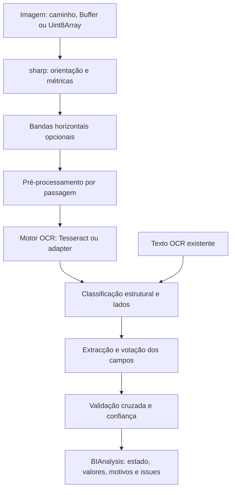

# BI Lens

**Biblioteca TypeScript para analisar imagens de Bilhetes de Identidade angolanos e extrair dados estruturados com sinais de confiança e revisão.**

[](https://www.typescriptlang.org/)
[](https://opensource.org/licenses/MIT)

## Visão geral

BI Lens é uma biblioteca reutilizável para integrar análise de documentos de identidade em aplicações Node.js. Recebe imagens, executa verificações geométricas, OCR e validações específicas do Bilhete de Identidade (BI) angolano e devolve dados estruturados acompanhados de confiança, avisos e uma decisão indicativa.

Pode ser integrada em serviços de onboarding, fluxos internos de validação ou ferramentas de desenvolvimento. A aplicação consumidora decide como tratar cada estado e continua responsável por qualquer decisão final de identidade. BI Lens não confirma a autenticidade do documento nem substitui uma revisão humana.

## Funcionalidades

- Entrada por caminho de ficheiro, `Buffer` ou `Uint8Array`; aceita imagem com os dois lados ou imagens indicadas separadamente. Referências externas podem ser resolvidas por URL ou por um adapter de armazenamento fornecido pela aplicação.
- Orientação EXIF, medição de nitidez e procura heurística de bandas de documento em fotografias verticais.
- OCR em português com Tesseract.js, três passagens por omissão e suporte para um motor OCR fornecido pelo consumidor.
- Classificação estrutural do BI angolano recente e deteção dos lados através dos marcadores impressos.
- Extração de número, nome, filiação, datas, sexo, estado civil, naturalidade, província, residência e altura.
- Validação sintáctica e cruzada dos campos, votação entre leituras, confiança por campo e global.
- Verificação de validade conforme a idade na emissão: 5 anos para idades até 20, 10 anos dos 21 aos 55 e vitalícia a partir dos 56. Para prazos definidos, a data esperada é emissão + prazo − 1 dia. Até 6 meses decorridos desde `validoAte`, a caducidade não altera por si só o estado; acima de 6 meses e até 1 ano encaminha para `needs_review`; acima de 1 ano resulta em `rejected`.
- Resultado de classificação (`isBI`), lados, estado (`approved`, `needs_review`, `rejected`), valores, motivos, issues e metadados. A confiança é heurística, não uma probabilidade calibrada.
- Diagnóstico opcional com texto OCR e valores extraídos sem formatação. Pode conter dados pessoais.
- API de texto em `bi-lens/text` para consumidores que já executaram OCR.

O suporte de documentos está actualmente limitado ao BI angolano recente, em português. O classificador usa marcadores e estrutura; não há templates configuráveis para outros países, detecção de autenticidade, comparação facial, correcção de perspectiva ou suporte ao BI antigo.

## Requisitos e instalação

- Node.js 20.9 ou superior para satisfazer o requisito da versão instalada de `sharp`; o pacote ainda não declara `engines` nos seus metadados.
- `sharp`, `tesseract.js` e `zod` são dependências de execução instaladas com o pacote.
- O modelo `por.traineddata` está incluído no pacote. A configuração padrão do Tesseract.js pode obter outros artefactos em runtime; para ambientes sem rede, configure e disponibilize também esses artefactos conforme a documentação do Tesseract.js.

O pacote não está publicado no npm neste momento. Na cópia local deste repositório, instale as dependências e compile:

```bash
cd bi-lens
npm install
npm run build
```

Após publicação, a instalação será `npm install bi-lens`.

O pacote é preparado para publicação pública no npm com `npm publish`; o hook `prepublishOnly` compila os bundles e declarações antes da publicação. A publicação exige autenticação npm e deve ser feita pelo responsável pelo pacote.

## Utilização

### Análise de imagem

```ts
import { createBILens } from "bi-lens";

const lens = createBILens({ minConfidence: 0.85 });
try {
  const result = await lens.analyze("./documento.jpg");
  console.log(result.status, result.confidence, result.values);
  if (result.status !== "approved") encaminharParaRevisao(result);
} finally {
  await lens.close();
}
```

`createBILens` mantém o motor OCR entre chamadas. Use `close()` para libertar os recursos quando terminar. Para uma chamada isolada, `analyzeBI(input, options)` cria e fecha a instância automaticamente.

Também são aceites entradas por lados:

```ts
const resultado = await lens.analyze({
  front: "./frente.jpg",
  back: "./verso.jpg",
});
const verso = await lens.analyze({ back: "./verso.jpg" });
```

As indicações de lado são verificadas pelos marcadores detectados; lados trocados são reordenados e sinalizados. Uma imagem combinada pode conter ambos os lados. Em fotografias verticais, são procuradas bandas horizontais densas e pode ser feito OCR por recorte. Não há correcção de perspectiva nem garantia para rotações arbitrárias.

### Fontes externas e buckets

Para URLs públicas ou assinadas temporariamente, use `urlDocumentSource`. Para referências guardadas num bucket R2, S3, Azure ou noutro serviço, implemente `DocumentSource` na aplicação e passe a fonte e as referências ao método `analyzeFrom`. A biblioteca não conhece credenciais, SDKs ou conceitos de um fornecedor específico: o método `load` da aplicação transforma cada referência em bytes da imagem.

```ts
import { createBILens, urlDocumentSource } from 'bi-lens';

const lens = createBILens();
try {
  const result = await lens.analyzeFrom(urlDocumentSource, {
    front: 'https://ficheiros.exemplo/bi-frente?assinatura=...',
    back: 'https://ficheiros.exemplo/bi-verso?assinatura=...',
  });
  console.log(result.status, result.values);
} finally {
  await lens.close();
}
```

Adapter para referências próprias da aplicação (por exemplo, chaves de objectos R2):

```ts
import { createBILens, createDocumentSource } from 'bi-lens';

const r2Source = createDocumentSource(async (objectKey) => {
  const response = await obterObjectoDoR2(objectKey);
  return new Uint8Array(await response.arrayBuffer());
});
const lens = createBILens();
try {
  const result = await lens.analyzeFrom(r2Source, {
    front: 'pedidos/123/frente',
    back: 'pedidos/123/verso',
  });
} finally {
  await lens.close();
}
```

`analyzeFrom` aceita uma referência única ou `{ front, back }`, carrega os bytes com a fonte indicada e executa a mesma análise de imagem. Para chamadas isoladas, `analyzeBIFrom(source, references, options)` cria e fecha o worker automaticamente. Erros da fonte e erros de descodificação/OCR são lançados ao consumidor. A fonte HTTP aceita apenas URLs `http:` e `https:` e verifica o estado HTTP; a validação do conteúdo da imagem é feita pelo descodificador da biblioteca.

### Entrada e resultado

`ImageInput` é `string | Buffer | Uint8Array`. Uma string é encaminhada para `sharp` como entrada de imagem. O resultado `BIAnalysis` inclui:

- `isBI`, `documentType` e `sides` para classificação;
- `status`, `confidence` e `reasons` para apoiar o fluxo de revisão;
- `values` com valores válidos ou `null`;
- `data` com valor, texto bruto, validade, confiança, correcções e votos por campo;
- `issues` com avisos/erros de validação, `checks` e `meta`;
- `debug` apenas quando solicitado.

Os erros de leitura da imagem, inicialização do OCR ou entrada inválida são propagados como excepções das dependências; envolva a chamada num `try/catch` adequado à aplicação. Para detalhes completos dos tipos, consulte os exports TypeScript em `src/angola/bi/types.ts` e `src/angola/bi/bi-document-analyzer.ts`.

### Opções

`LensOptions` permite configurar `minConfidence` (0.85 por omissão), `rejectBelow` (0.4), `ocrConfidence` quando não há confiança por palavra, `now` como data de referência, `critical` para substituir os campos críticos, `debug`, `langPath`, `passes` e `engine`. Os valores numéricos são limitados a 0–1, excepto `ocrConfidence` (0–100). Cada passagem configura largura e modo de segmentação (`psm`); a configuração padrão usa três escalas.

Os campos críticos padrão variam com os lados detectados. `critical` e os limiares influenciam o estado, mas não alteram a extracção. Mesmo `approved` é apenas uma indicação produzida pelas regras implementadas, não uma decisão de identidade.

### Apenas texto

Quando a aplicação já dispõe de OCR, use a entrada leve, que não carrega `sharp` nem `tesseract.js`:

```ts
import { parseBI } from "bi-lens/text";

const resultado = parseBI(textoOCR, { minConfidence: 0.85, ocrConfidence: 90 });
```

Também aceita `{ front, back }` com texto OCR de cada lado. Esta API ainda aplica as regras de estrutura, extracção e validação próprias do BI angolano; não é um parser genérico de qualquer documento.

### Diagnóstico

```ts
const resultado = await lens.analyze("./documento.jpg", { debug: true });
console.dir(resultado.debug, { depth: null });
```

O diagnóstico inclui texto OCR e valores brutos. Trate-o como dado sensível e evite guardá-lo em logs ou partilhá-lo sem autorização.

## Stack tecnológica

| Área                  | Tecnologia actual                                                                                         |
| --------------------- | --------------------------------------------------------------------------------------------------------- |
| Linguagem e runtime   | TypeScript 5.9, Node.js; módulos ESM e CommonJS gerados                                                   |
| Imagens               | `sharp` para orientação, metadados, recortes, transformação e nitidez                                     |
| OCR                   | `tesseract.js` com modelo português incluído (`por.traineddata`)                                          |
| Classificação e texto | Implementações locais de correspondência aproximada, normalização e parsing; sem dependência ML adicional |
| Validação             | Zod para opções e schema de resultado                                                                     |
| Build                 | tsup e TypeScript                                                                                         |
| Testes                | Vitest; testes actuais cobrem parsing de lados e linhas OCR                                               |

## Arquitectura e fluxo

`src/index.ts` é a entrada principal e exporta a API de imagem e de texto. `src/text.ts` é uma entrada reduzida para consumidores que já têm OCR. A implementação específica do BI está em `src/angola/bi/`; utilitários genéricos de OCR, imagem, classificação e normalização estão em `src/core/`.



O analisador prepara cada entrada, processa uma ou mais passagens de OCR, combina texto e palavras posicionadas quando disponíveis, classifica a estrutura e finaliza os campos esperados para os lados encontrados. A geometria ajusta a confiança global; a validação textual produz o resultado. O caminho `bi-lens/text` começa no texto e evita dependências de imagem e OCR. `OcrEngine` é o ponto de extensão para fornecer um motor compatível.

## Desenvolvimento

### Preparar e compilar

```bash
npm install
npm run build
```

O build gera `dist/`, que é usado pelos exemplos e pela ferramenta local através dos exports do próprio pacote. Repita `npm run build` depois de alterar o código-fonte antes de usar essas ferramentas.

### Analisar documentos próprios

`scripts/analyse.mjs` é uma ferramenta de desenvolvimento sobre a API pública; não inclui imagens nem caminhos predefinidos. Passe um ficheiro seu ou indique explicitamente os lados:

```bash
node scripts/analyse.mjs ./caminho/documento.jpg
node scripts/analyse.mjs --front ./caminho/frente.jpg --back ./caminho/verso.jpg
node scripts/analyse.mjs --back ./caminho/verso.jpg --debug --min-confidence 0.9
node scripts/analyse.mjs --help
```

Os caminhos são resolvidos pelo processo Node relativamente ao directório de execução. A ferramenta mostra a classificação, lados, estado, confiança, valores e motivos. `--debug` acrescenta os detalhes de OCR; use-o apenas com documentos cujos dados pode visualizar. `--min-confidence` aceita um número de 0 a 1. Para desenvolver processadores ou alterar o pipeline, execute a ferramenta com amostras autorizadas e compare os campos, issues e diagnósticos antes/depois; converta casos importantes em testes de texto ou fixtures controladas.

`examples/debug.mjs` guarda recortes e texto OCR para inspecção local. Requer um build recente e um caminho indicado pelo utilizador:

```bash
node examples/debug.mjs ./caminho/documento.jpg
BI_DEBUG_DIR=/tmp/bi-lens-debug node examples/debug.mjs ./caminho/documento.jpg
```

Os ficheiros de diagnóstico podem conter dados pessoais. A ferramenta de regressão baseada em imagens de amostra foi removida juntamente com essas imagens; os testes automatizados não dependem de documentos reais.

### Scripts disponíveis

| Comando                        | Finalidade                                              |
| ------------------------------ | ------------------------------------------------------- |
| `npm run build`                | Gera bundles ESM/CommonJS e declarações em `dist/`      |
| `npm run typecheck`            | Verifica os tipos sem emitir ficheiros                  |
| `npm test`                     | Executa a suite Vitest                                  |
| `npm run analyse -- ...`       | Encaminha argumentos para a ferramenta de análise local |
| `node scripts/analyse.mjs ...` | Analisa imagens indicadas pelo programador (após build) |

## Testes e qualidade

```bash
npm run typecheck
npm test
npm run build
```

Os testes actuais são determinísticos e usam texto/imitações de palavras OCR, sem imagens de BI. Para acrescentar casos, prefira texto anonimizado ou dados sintéticos; não versione documentos pessoais.

## Estrutura do projecto

```text
src/
  angola/bi/       análise, parsing, validação, layout e tipos do BI angolano
  core/            imagem, OCR, normalização de texto e correspondência aproximada
  index.ts         entrada pública completa
  text.ts          entrada pública apenas textual
scripts/           ferramentas de desenvolvimento
examples/          exemplo de diagnóstico OCR
assets/            modelo português do Tesseract
tests/             testes Vitest
```

## Contribuições

Contribuições devem manter a separação entre utilitários genéricos em `src/core/` e regras específicas de documentos em `src/angola/bi/`. Inclua testes para alterações de comportamento, actualize os exemplos/documentação quando a API pública mudar e não adicione imagens de identidade reais ao repositório.

## License

This project is distributed under the MIT License. See [LICENSE](LICENSE).

## Roadmap

Os itens seguintes são possibilidades planeadas e **não fazem parte das funcionalidades actuais**.

### Verificação facial — selfie vs. BI

Investigar uma etapa opcional para detectar rostos na selfie e na fotografia do documento, alinhar/pré-processar as imagens e calcular similaridade facial com limiares configuráveis. O resultado poderá incluir uma pontuação de confiança para ajudar a verificar se o titular corresponde à pessoa que realiza a verificação.

### Investigação de autenticidade do documento

Estudar sinais visuais e estruturais, como brasões, insígnias, layout, posição esperada dos campos, consistência visual e possíveis adulterações. Templates específicos por país, incluindo características do BI angolano, podem ser avaliados. Estes sinais seriam heurísticos e não garantias de autenticidade.

### Multi-source Document Processing

A resolução de URLs e referências de armazenamento já é suportada através de `DocumentSource`. Integrações específicas adicionais podem ser mantidas na aplicação consumidora ou publicadas como adapters independentes, sem acoplar o núcleo da biblioteca a SDKs de buckets.
